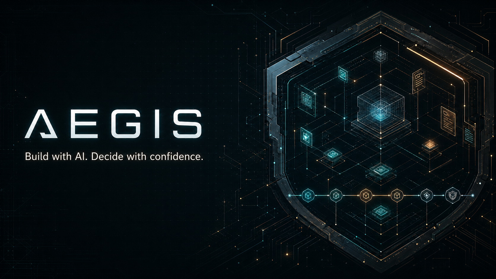

# Aegis v2.1.0 for Hermes: Leaner and Meaner

Aegis helps an AI coding assistant turn an idea into bounded work, tested changes, and reviewable decisions. It keeps the useful stage gates while scaling the paperwork to the actual risk.

This is the **Hermes port** of [the original Aegis Codex skill](https://github.com/dotnetdavid/aegis), created by David A. Frey. The Codex original lives on GitHub; the Hermes port lives on GitLab. The original MIT license, copyright and permission notice are preserved in [LICENSE](LICENSE) and with the distributed skill. See [PORT-NOTES.md](PORT-NOTES.md) for pinned provenance and host adaptations.

This is a local review candidate for Hermes **2.1.0**. Use native `/aegis`; the invocation does not change with the version. Ask “What version of Aegis is loaded?” to read the live skill metadata without starting a workflow.

## How it works

V2.1.0 adds one risk/control matrix and a compact brief for eligible reversible work; standard and higher-risk work retain their applicable controls. Candidate branch or MR actions, CI effects, merge, and promotion require separate authority.

The PM coordinates scope, requirements, delegation, evidence, and communication without implementing product changes. Coder, Tester, SecOps, and Documentation roles do the work needed for the assignment. Independent review remains independent of the coordinating PM.

The nine gates remain: scope, build package, pre-code review, execution authorization, acceptance, commit, deployment, post-deployment acceptance, and push/MR/closeout. Applicability and evidence scale with risk. Explicit owner delegation can authorize bounded routine development decisions; it does not authorize new spending, expanded scope, production promotion, or public release.

Each governed project has one current `spec.md`. Run-specific build packages refer to that specification rather than creating competing specifications. Decisions and verification evidence remain inspectable.

Aegis is procedural guidance for an assistant, not a sandbox, permission system, or guarantee that an agent cannot leave its mandate. Host permissions and human review still matter.

## Install

Use one active `aegis` slot in the discovery location for your actual Hermes profile. A profile-local installation normally copies the complete `skill/aegis` directory, including every reference and its MIT license, to `<active HERMES_HOME>/skills/software-development/aegis`. A `git pull` updates an installation only if Hermes discovers that checkout directly. If it discovers a separate copy, replace the entire package; do not merge old and new files.

Stage and verify the release outside live discovery. Close affected Hermes sessions; with owner approval for the exact locations, replace the one active slot without exposing a duplicate or stale copy. In a fresh session, verify the resolved source and version. Check for project-local or external sources which may shadow the active slot. On failure, stop without any restore, checkout or copy. Propose the prior Hermes release from [GitLab history](https://gitlab.com/dotnetdavid/aegis-hermes) by immutable commit and package digest, and name the exact destination. Obtain separate explicit scoped owner approval, including G7 for the active installation, before taking any recovery action. Do not use the Codex distribution or a second local copy. Windows and WSL may resolve separate profiles. See the [Hermes skills documentation](https://hermes-agent.nousresearch.com/docs/user-guide/features/skills).

Before starting Hermes, create and enter the project directory. A shell's current directory is not changed by a request to save the final result somewhere else. Verify the actual working directory and writable scope before any file creation. Never start a trial inside a credentials directory.

## Getting started: calculator demo

1. Follow the install steps above, then open a fresh Hermes session in an empty,
   isolated project folder. Before any writes, confirm the actual `aegis` source, top-level version 2.1.0,
   working directory, and writable scope.
2. Open the [baseline prompt](examples/calculator/calculator-create.md) and
   paste its text block into Hermes. Expect a self-contained offline calculator
   with keyboard support, tested arithmetic, and recoverable errors.
3. After reviewing and accepting the baseline, paste the
   [percent prompt](examples/calculator/calculator-percent.md) into the same
   project. Expect unary percent: 5% = 0.05, 50 × 5% = 2.5, and
   200 + 10% = 200.1. Keep the original regression checks.

Keep all project outputs in the isolated folder. Neither step requires a
commit, deployment, or publication. The Hermes port and adapted prompts are included here.

## Models and effort

Use an approved project mapping to models actually available in the host. Record the actual model and reasoning route when exposed; otherwise mark them unknown. The proposed per-role model/effort/speed selection dialogue is not included in this candidate.

## Validation and limits

The following two paragraphs retain the original repository's **historical Codex validation**. They are not Hermes-port test results.

Owner-provided PowerShell and WSL Codex session reports exercised a new calculator and a small percent enhancement using the lean UAT source. Both reported test-first work, regression checks, independent reviews and scoped gate closure. PowerShell used Firefox; WSL used Chromium with owner-run assistance when the automated browser sandbox was unavailable. These are owner-reported outcomes from the earlier lean source. A fresh rerun of this packaged example was deferred; no new calculator pass is claimed.

The percent iteration reported 98 PowerShell acceptance cases plus the archived 58-case regression, and 102 WSL core cases plus the archived 63-case regression. Browser reports covered 20 Firefox groups and 31 Chromium checks. Counts are different suites, not a quality ranking or a controlled speed benchmark. No screen-reader certification, hard agent-containment proof, universal host compatibility or performance guarantee is claimed.

[VERIFICATION.md](VERIFICATION.md) records historical v2.0 packaging evidence only. This v2.1.0 candidate has not been run in Hermes or through either calculator prompt. See [PORT-NOTES.md](PORT-NOTES.md) and [RELEASE-NOTES.md](RELEASE-NOTES.md) for scope and limits.

## Creator and license

Created by David A. Frey.

Copyright (c) 2026 David A. Frey. Licensed under the [MIT License](LICENSE). You may use, modify, and redistribute this work, including commercially, subject to the license terms. Keep the copyright and permission notice with copies or substantial portions.
